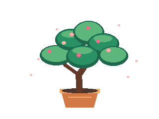
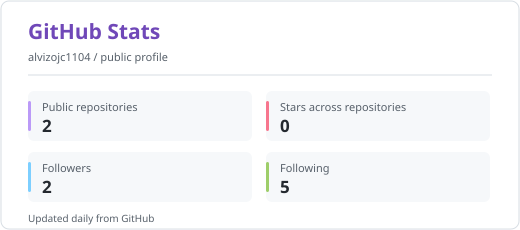
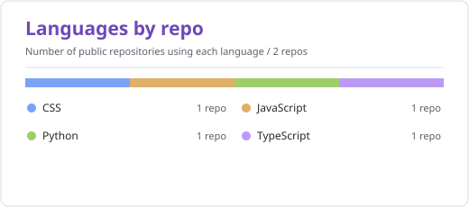

 

<a href="https://github.com/alvizojc1104">
  <picture>
    <source media="(prefers-color-scheme: dark)" srcset="assets/stats-dark.svg" />
    
  </picture>
</a>
<a href="https://github.com/alvizojc1104?tab=repositories">
  <picture>
    <source media="(prefers-color-scheme: dark)" srcset="assets/languages-dark.svg" />
    
  </picture>
</a>
 
